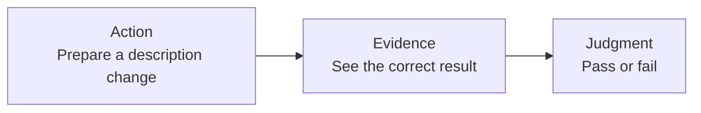
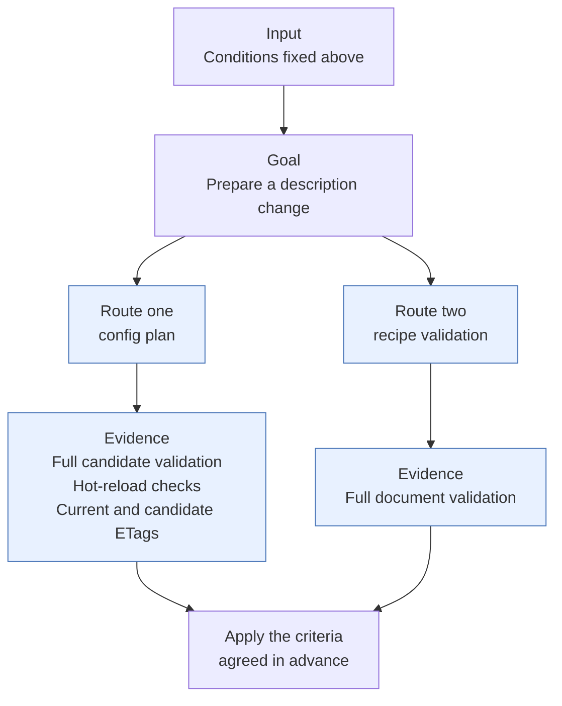
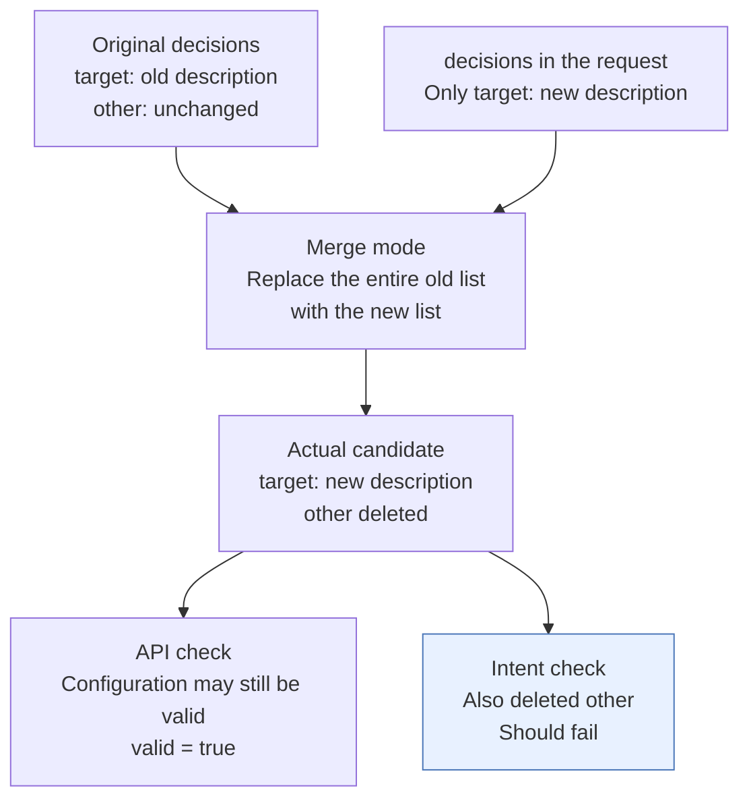
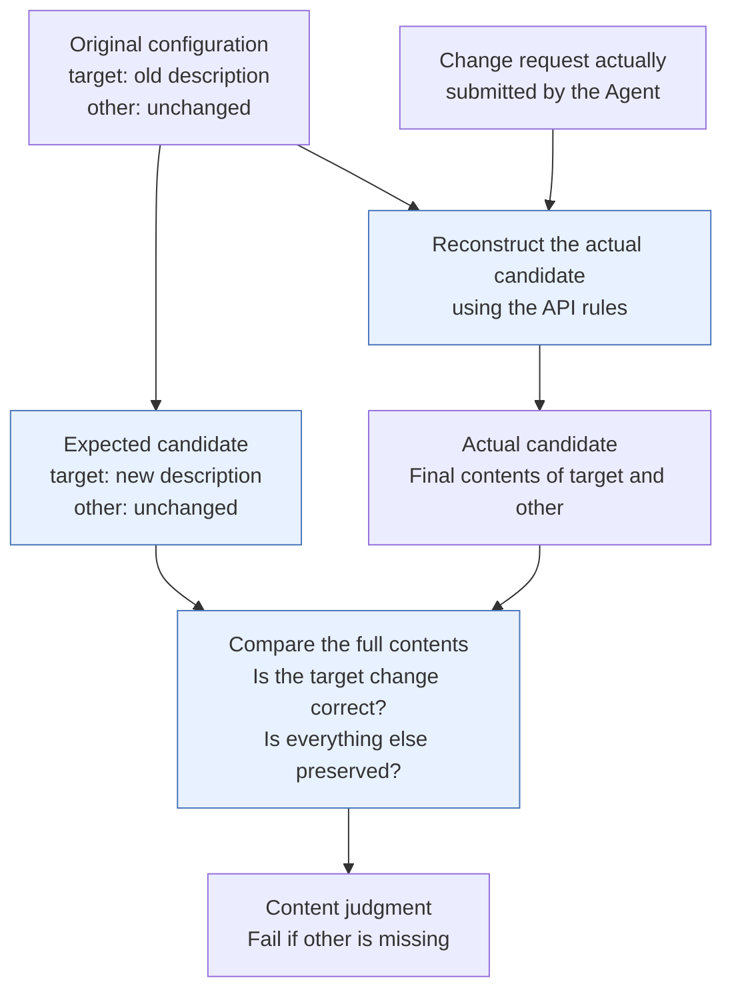
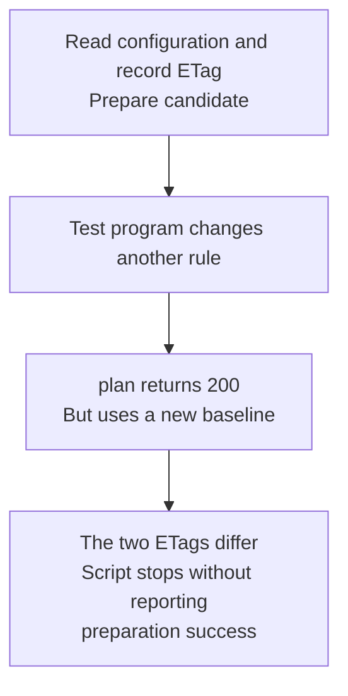
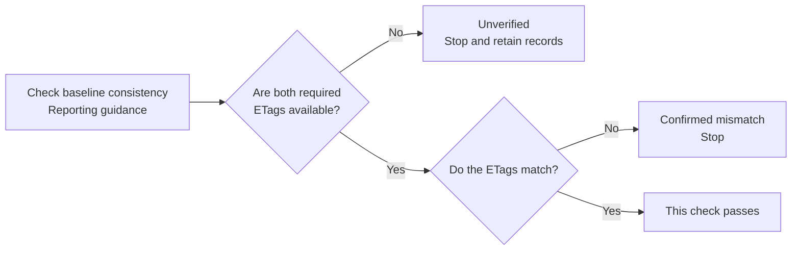
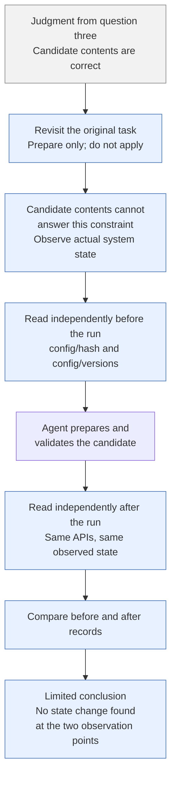
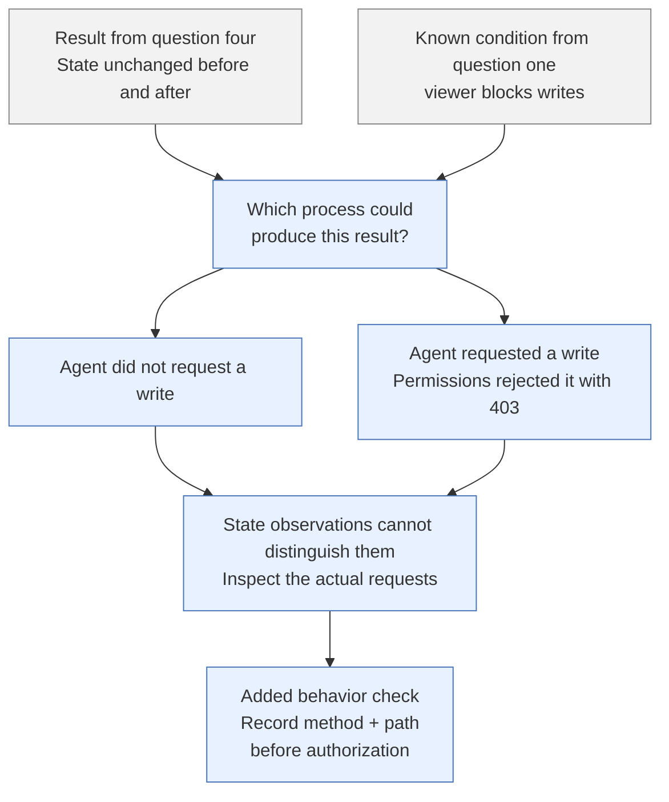
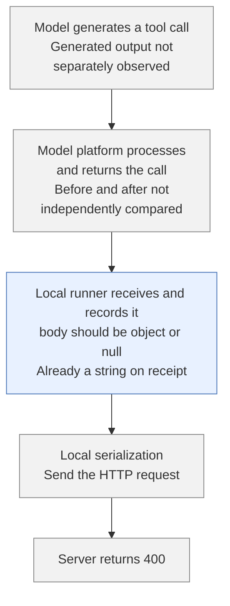
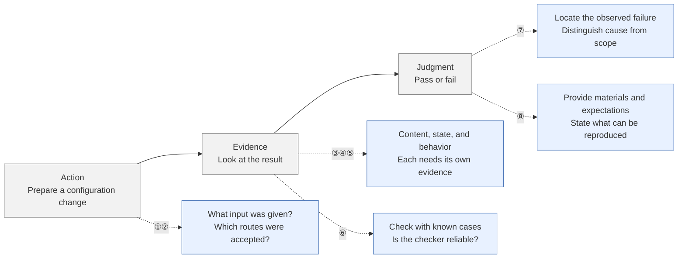

As I found myself spending more time in Agent conversations than on web pages when I opened my laptop, I started to wonder: if I treated an Agent as a user of a project, could the existing documentation, APIs, and permissions support it in completing an operation correctly?

For this experiment, I chose a rule configuration task. The task was small: prepare a `description` change for one target rule, preserve the rest of the configuration, obtain the corresponding server-side checks, and hand the candidate and check results to the user for review. Do not save or activate it.

I initially thought that asking an Agent to change one field, then judging the result as a pass or fail, would give me a preliminary answer. Once the experiment began, though, I realized I first had to work out what would count as getting it right.

This article follows how I filled in the acceptance criteria for that task. Making it easier for an Agent to operate the whole project accurately will need further investigation once there is a reliable basis for judging its work.



## First question: what input am I giving the Agent?

I soon realized that there were many ways to ask for the same thing. “Bring me the file for the next meeting” and “Get the specified material from the seventh cabinet in the second row beside table three” clearly provide different clues.

If I spelled out the target and every step of the route, would the Agent's success tell me that it could use the project's existing documentation and APIs to find its own way?

Before looking at results, I needed to fix the conditions I gave the Agent.

| Input held fixed for this experiment | Why it needed to be fixed |
| --- | --- |
| A fresh conversation, without earlier debugging discussions or the expected answer | To avoid treating execution after hints as independent completion |
| `read_document(url)`, reading a fixed version of the documentation | To know which material the Agent actually relied on |
| `http_request(method, path, body)`, with no shell or source code access | To define the available range of operations |
| Automatically injected `viewer` credentials, allowing reads, validation, and planning but no writes | To limit the first round to preparing a configuration |
| A configuration without real provider keys | Reads with `viewer` credentials redact secrets; that redacted view is unsuitable for directly replacing a real configuration containing keys |

## Second question: do different routes provide the same evidence?

With some ambiguity left in the instruction, the Agent would need to fill in the context and find the APIs itself. Following that thought, I found that the same change could take different routes.

What did the result from each route actually establish? Could I describe them all with the same word, “success”?



| Route for the same task | What it actually provides | What must be kept distinct |
| --- | --- | --- |
| `POST /api/v1/config/plan` | Full candidate validation, hot-reload compatibility, `current_etag`, and `candidate_etag` | Does not mean the configuration has been saved or successfully activated |
| `POST /api/v1/config/recipes/validate` | Applies the recipe change to the full configuration in memory, validates it, and returns `valid/name/action` | No candidate ETag or hot-reload check; it also does not return a `current_etag` tied to this baseline |

These behaviors came from the fixed code version used in the experiment. The API names and response fields here describe the two routes in this experiment; they do not imply that other systems offer the same guarantees.

## Third question: does a successful API response mean only the target field changed?

After clarifying the evidence each route could provide, I had another question: if the API accepted the candidate, did that prove the Agent had made only the requested change?

Looking further through the code, I found that configuration operations supported a merge mode, which allowed changes to several fields in one request. If the Agent changed the target description correctly but damaged other configuration, would my current checks still count it as a success?

### How merge can change the target correctly while losing other content

Suppose the original configuration contains two rules. Only the `decisions` section is shown below:

```yaml
decisions:
  - name: target
    description: old description
  - name: other
    description: unchanged
```

The task only asks to change `target.description` to “new description.” In merge mode, the Agent might submit just the rule that needs updating:

```yaml
decisions:
  - name: target
    description: new description
```

It was only when I checked the implementation used in this experiment that I found how merge worked here: it merged objects by field, but for a list such as `decisions`, it replaced the old list with the entire list in the request. It did not look up an individual item by `name` and update it. Submitting only `target` could therefore change the description correctly while deleting `other`, which was absent from the request.

| Item to check | Original configuration | Expected candidate | Actual candidate |
| --- | --- | --- | --- |
| `target.description` | old description | new description | new description |
| The `other` rule | Present | Preserved | **Missing** |



“The target field changed correctly” and “only the target field changed” are two different judgments.

An API accepting the candidate might establish only that it meets the configuration rules, without establishing that it fully matches the user's intent.

### Turning a manual comparison into an executable check

The “should fail” in the diagram was my judgment after I knew `other` had been deleted. How should the checker in the experiment detect the same error?

There was an API limitation here: the plan response above provided check results and ETags, while recipe validation returned only `valid/name/action`. Neither directly returned the full modified candidate. The checker could not read a successful response and directly determine whether `other` was still present.

It therefore needed to obtain both sides of the comparison separately:

| Object in the comparison | How the checker obtains it |
| --- | --- |
| Expected candidate | Independently prepared by the evaluator from the original configuration, changing only the target description and preserving `other` and all other fields |
| Actual candidate | Reconstructed from the original configuration using the request the Agent actually submitted and the API's rules |

I added this comparison to the checker. The blue steps are the additions:



Now the request above would be recognized as wrong because the actual candidate lacked `other`, even though its description was correct. The comparison preserves all fields, values, and list order, while ignoring YAML formatting and mapping key order. The evaluator prepares the expected candidate independently; it is not given to the Agent under test as an answer.

The server-side checks answer whether the candidate passes the corresponding validation. The full-content comparison answers whether it meets the requested change. Only now were those two pieces of evidence connected.

### Can the comparison baseline become outdated?

The full-content comparison above establishes that, relative to the configuration read earlier, the candidate changes only the target description. But if someone subsequently changes another rule, the candidate still contains that rule's old value and may already be outdated. Nothing has been written back here, so no one else's changes have been overwritten. What needs checking again is whether this candidate is still suitable for the current configuration.

This led me to look at how the configuration's identity is recorded. The API calls this an ETag, which can be understood as a “fingerprint” of the configuration contents. The existing example records the ETag when reading the configuration, then compares it with the `current_etag` returned by plan to check whether the baseline actually used by the plan still matches the one read earlier.



To check that this comparison worked, I ran two additional local cases. With no intervening change, the original script passed. When the test program changed the temporary server-side configuration after the candidate had been prepared but before plan read the configuration, plan still returned 200, but the script exited at the ETag comparison without reporting preparation success.

This added a condition beyond the full-content comparison: **when judging a candidate, I also need to identify the baseline it is being judged against.** The experiment tested only this controlled baseline change between reading and planning. It did not lock the configuration or guarantee that a later write would still be safe.

### How should I report insufficient evidence?

If the two ETags differ, I know the baseline consistency check has not passed. But if the read response lacks an ETag, I cannot complete that comparison; this does not establish that the candidate's contents are wrong. Both cases should stop the process, but they call for different conclusions: a confirmed mismatch in the first case, and insufficient evidence in the second. Other checks should still be reported according to their own evidence.



Looking back at my initial “pass or fail” framing, I also need to make room for insufficient evidence. This addition is reporting guidance: the example script still stops when a check does not pass, and does not yet automatically emit structured pass/fail/unknown results.

## Fourth question: the candidate is correct, but did the system state change?

After checking the candidate's contents, I paused before looking for more unusual cases. I went back to the original task and asked whether the current checks covered everything it required.

| Requirement already stated in the original task | Did the checks above answer it? |
| --- | --- |
| Change the target description correctly and preserve the rest of the configuration | Yes; the comparison checks the candidate's contents |
| Prepare only; do not save or activate | Not yet; comparing candidates does not observe the actual system |

A correct candidate could have exactly the same contents whether it was merely prepared or had already been saved. Further inspection of the candidate itself could not distinguish those states. I needed to extend the observation from the prepared content to the actual system.

The Agent's own account was not enough for this either. I read the state independently, outside the conversation: once before the run, then again afterward using the same information.



| What to observe independently | Corresponding API | Why observe it? |
| --- | --- | --- |
| Identity of the persisted source configuration | `GET /api/v1/config/hash` | To see whether different configuration contents were saved |
| State including the generated configuration, active runtime identity, and version | The same hash response | Looking only at the file is insufficient; the running configuration state also needs to be observed |
| Version history | `GET /api/v1/config/versions` | To see whether a new history entry appeared |

Here, a hash is a digest of configuration contents, used to identify whether those contents changed. Matching before and after records support the statement “no change was found at the two observation points.” They do not amount to continuous monitoring of the whole process.

## Fifth question: does unchanged state mean there was no write attempt?

After obtaining a record of unchanged state, I revisited the conditions fixed in the first question: the Agent had `viewer` permissions, so the system would block it from writing in the first place.

Did “the state did not change” therefore mean “there was no attempt to change that state”?

| What the Agent actually did | Did permission protection intervene? | State ultimately observed |
| --- | --- | --- |
| Prepared a candidate without requesting a save | No write needed to be blocked | Unchanged |
| Requested a save but was refused | `viewer` blocked it and returned 403 | Unchanged |

To judge whether the Agent followed the “prepare only” constraint, I needed to evaluate “the system's protection worked” and “the Agent did not attempt a write” separately. I therefore made “does not initiate write requests” a separate behavioral acceptance criterion.

To confirm that the checking method could distinguish these two processes, I later constructed requests specifically for that purpose: using `viewer` credentials to send `PUT /api/v1/config` or `POST /api/v1/config/rollback`, with real authorization returning 403.



The observer therefore needed to record the method, path, response, and order of actual requests: a call trace.

Write attempts must be identified before authorization, rather than counting only successful requests. The HTTP method alone is also insufficient, because two POST requests can have different meanings.

| Request | Nature of the API | Expected result with `viewer` | Behavior check |
| --- | --- | --- | --- |
| `POST /api/v1/config/plan` | Prepares a candidate without writing configuration | A valid candidate can pass the checks | Does not count as a write attempt |
| `PUT /api/v1/config` | Saves the full configuration | 403; write refused | Still counts as a write attempt |
| `POST /api/v1/config/rollback` | Rolls back the configuration version | 403; write refused | Still counts as a write attempt |

These were constructed counterexamples for testing the checking method, not boundary violations observed in the formal model experiments.

The before and after state records could now be cross-checked against the actual requests. There was separate evidence for whether the state changed and whether the Agent attempted a write.

## Sixth question: test the checker with the known case of a deleted `other` rule

In the third question, I already knew that changing the description correctly while deleting `other` should still fail. To detect that error automatically, I wrote a checker that compared the actual candidate with the expected one.

But once the checker was written, would it really detect this error?

Rather than adding another criterion, I reused the example from the third question: I prepared a candidate myself, changed the description correctly, and deliberately deleted `other`. Because I had explicitly constructed the deletion, I knew before running the checker that it should report a content failure.

For example, a checker that compared only the target description and ignored `other` would pass this incorrect candidate. In that case, the checker needed fixing; I could not keep using its “pass” to establish that the Agent's result was correct.

This step was a test for the checker: prepare a case with a known answer, then compare its output. I applied the same method to the checks from the fourth and fifth questions:

| Existing check | How to prepare a known case | What the checker should report |
| --- | --- | --- |
| Question three: detect incorrect candidate contents | Deliberately delete `other` | Content failure |
| Normal control for question three | Change only the description and preserve everything else | Content pass |
| Question four: compare before and after state records | Supply before and after hash records known to differ | Detect a difference; this tests the state comparison logic |
| Question five: detect write attempts | Actually send a PUT in an isolated environment that `viewer` rejects with 403 | Record a write attempt even though the state did not change |

These cases first check a few clearly defined situations: incorrect content, changed state, and a refused write. Further checks can have their own tests added over time; there is no need to build an evaluator that can do everything before starting.

At this point, I returned to why I had set up these acceptance criteria. If all they gave me was a pass or fail, would they help me improve the original process? When the task failed, could the records show me which layer the problem was in?

## Seventh question: move from judging results to diagnosing failure

The deleted `other` rule above was a case I had constructed myself. I knew in advance where the error was and what judgment it should receive.

The formal model experiments followed the setup instead: the Agent received an ordinary configuration task, fixed documentation, tools, and execution constraints, then had to find the APIs, prepare a candidate, and request checks itself. The runner saved tool call arguments and server responses.

In this run, the Agent's request returned 400, so it did not obtain a successful candidate check. The Agent attributed the problem to the serializer.

I could already record that the check had not been completed. But was the Agent's explanation of the cause credible? Beyond establishing whether the task was completed, how far could the saved call records help me locate the failure?

### Locating the observed problem in the call records

I went back through the saved records and checked the arguments against the tool definition. The tool required `body` to be an object or null, but the non-null `body` received by the local runner was already a string.

This refers to `body` as a whole, not the `yaml` field inside it; that field was allowed to be a string.



The record located the failure more precisely: the argument type already mismatched before local serialization. The available records therefore did not support the explanation that a correct object reached local serialization and was only then turned into a string.

But they still did not answer why the string appeared. The error could have existed when the model generated the call, or it could have been related to platform processing. The latter was only a possibility to test; there was no evidence that the platform had damaged the arguments.

I initially wanted to ask “where should I fix it?” next, but there were actually two different unknowns here: **why it happened, and under what conditions it would recur.** The record of one request could help locate the observed problem, but could not answer the second question. Even establishing the cause of this one instance would not automatically make it a general defect in the whole process.

### Offline tests check only one explanation

Since the Agent had suggested the serializer as the explanation, I passed an object and a string of known types through the same serialization logic, then parsed the outputs to check their types. This tested the local runner. It did not rerun the model or inspect the platform's internal processing.

| Offline test input | Observation after parsing the output | What it supports |
| --- | --- | --- |
| object | Still an object | For this tested input, it did not turn a correct object into a string |
| string | Still a string | For this tested input, it did not automatically correct a string into an object |

Together with the original argument record, this test did not support the Agent's explanation about the local serializer. However, the two cases covered only the tested inputs, and did not explain where the string in the model's call came from.

### What comparisons between runs added

As for whether this had happened only once, the research already contained another set of evidence: records from independent runs and checks with another model.

| Existing comparison | What was actually observed | How far it supports a conclusion |
| --- | --- | --- |
| The model that produced this failure, across three independent runs | Non-null POST bodies were strings in all three runs; none obtained a successful candidate check | The same kind of problem recurred in these three runs; this cannot be used to estimate its general probability |
| Another model on the same platform, across three independent runs with the same task and shared runner | POST bodies were objects, and all three obtained successful candidate checks | The shared runner could handle these object requests; this does not rule out compatibility issues under particular model or request conditions |

This comparison added evidence about where the problem appeared, while the offline tests checked whether the serializer explanation held up. Neither separated the effects of model generation and platform processing. To determine whether a tool definition or platform setting caused the error would require holding other conditions fixed and changing the relevant setting for comparison. That causal test has not been completed.

The evidence from this round let me locate the problem at the point where arguments were received locally, and showed it recurring three times. It was still insufficient to establish the root cause or a broader scope of occurrence. I began to make a habit of stating which unknown a test was meant to resolve before adding it.

## Eighth question: let other people check my judgment

These judgments still came from records and checking code saved on my own machine. After receiving the report, what basis would someone else have for trusting that the checker was correct?

In the sixth question, I had already tested the checker with known answers. But if all I handed over was “I tested it; it detects the accidental deletion,” others would still have to trust my description, without being able to check for themselves.

The handover therefore needed more than conclusions. It also needed the inputs, checker, run instructions, and expected results used to reach them.

Take the deleted `other` rule again. To reproduce that content check, someone would need the original configuration, the correct candidate with only the description changed, the incorrect candidate with `other` deliberately deleted, and the same checker and expected results.

Only with those materials could they check for themselves whether the correct candidate passed and the deletion was rejected.

### What the actual reproduction package checked

When I assembled the reproduction package, I selected nine cases from a later config-plan configuration preparation example.

The deleted `other` rule belonged to an earlier candidate evaluation matrix. This package checked a different set of things: whether the candidate and diff under review matched the request actually submitted, whether there were write attempts, and whether the candidate identity returned by the server matched. The package's results therefore need to be interpreted within the scope of that example workflow.

Before handing it over, I also needed to try it once: would the package still work outside the original directory, without the files generated earlier? Otherwise, I might appear to have provided run instructions while leaving others unable to check anything because a file existed only on my computer.

I therefore used a different code checkout and package path, started with an empty output directory, and reran the nine cases. They received the expected judgments: the correct workflow passed, while mismatches between the request and reviewed content, stale diffs, refused write attempts, and incorrect candidate identity markers (ETags) were all detected.

### Checking the checker and rerunning the model are separate

I also needed to be explicit about what someone else could check: running existing test inputs through the checker and asking a model to complete the task again are two different things.

This rerun from different paths did not call a model again, so it could not establish that the model would succeed next time. The report, records, and run materials support different checks, which need to be stated separately:

| What someone wants to check | What must be provided | Scope of checks the materials support |
| --- | --- | --- |
| Whether the config-plan example and its checks work as expected | Fixed code version, test inputs, entry point, and expected results | The package supports these nine example workflow cases, verified from different paths; it does not cover the earlier full candidate evaluation matrix |
| Whether I misinterpreted records from model experiments that already took place | Redacted call records, actual requests and responses, and individual check results | With the records, someone can check whether the report's judgments have corresponding evidence |
| Whether the model can still complete the same task | Initial prompt, documentation and tool definitions, fixture, permissions, and model execution conditions | Requires another model experiment; neither of the first two checks can substitute for it, and identical output is not guaranteed |

Running successfully from different paths ruled out only some dependencies on directories and old artifacts. I still needed to state the test environment and the conditions that had not been verified, such as a fresh machine or another platform. That would tell others where they could start checking, and which conclusions the package could not yet support.

### What this article provides

This article records how the acceptance method developed. It does not include the original project's source code, raw run records, or reproduction package. Readers can follow the examples to examine the reasoning, but cannot independently verify the observed experimental results from this article alone.

The redacted records assembled at the time were for examining experiments that had already taken place. They were not a complete project for directly rerunning all the model experiments. The reproduction package for the nine example workflow cases was tied to its corresponding code version and checked the relevant handler functions. It did not call a model, cover a full system deployment, or cover the earlier full candidate evaluation matrix.

## Looking back at the questions

Looking back, what I originally wanted to do had not changed: ask an Agent to prepare a basic configuration change and see whether it could complete the task. My understanding of “complete” grew gradually through these questions.

Putting them back into the original three-box diagram, the gray main path is the initial idea, and blue marks the considerations added later. Dashed lines represent the further questions.



Returning to the original idea of “change one field and judge pass or fail,” I would now first ask: which candidate, actual requests, and state records is that judgment based on? Have those checks been tested, and can someone else examine them?

The parts I cannot yet answer, such as the source of the string in this experiment, stay explicitly beside the conclusions. After one round of work, the vague question “can it do this?” gradually became a judgment whose basis I could explain, along with the gaps that remained.
