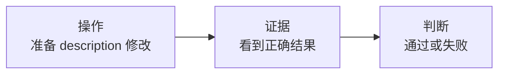
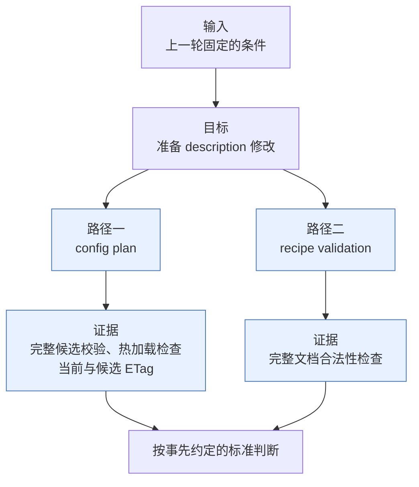
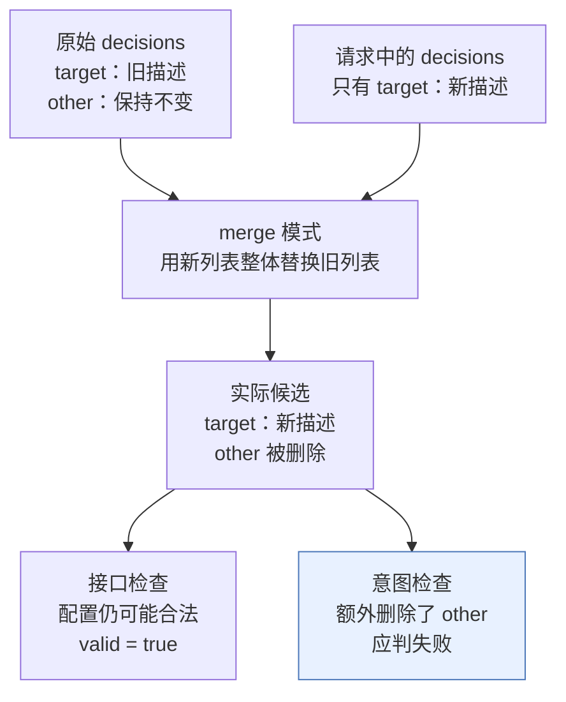
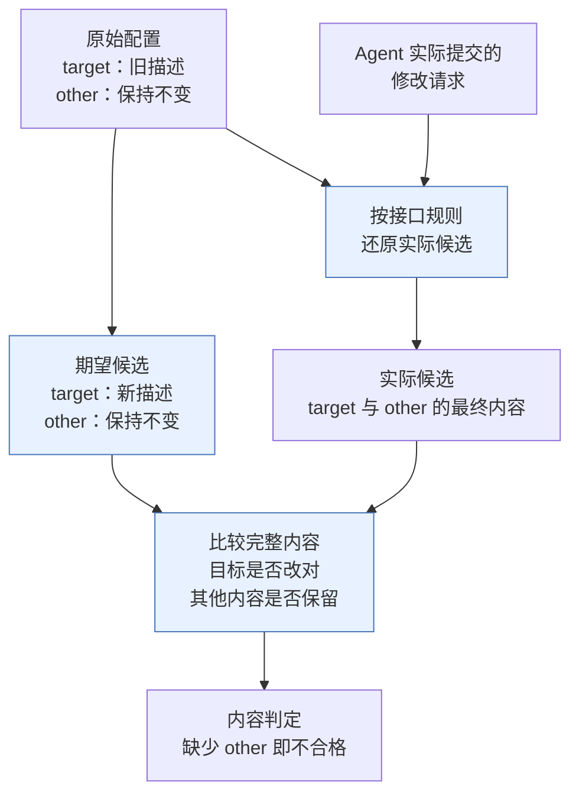
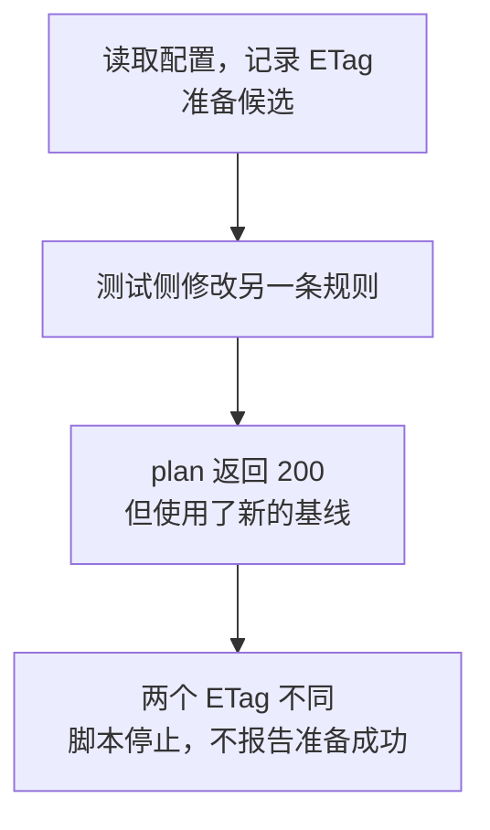
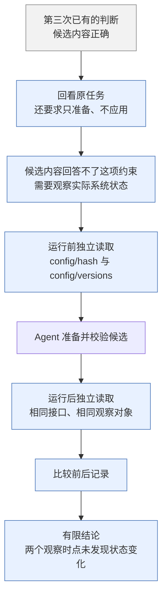
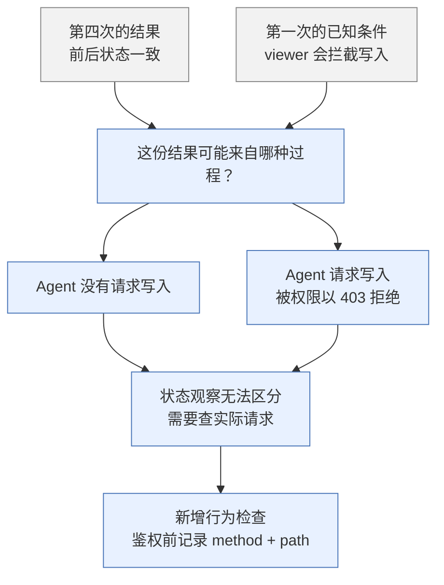
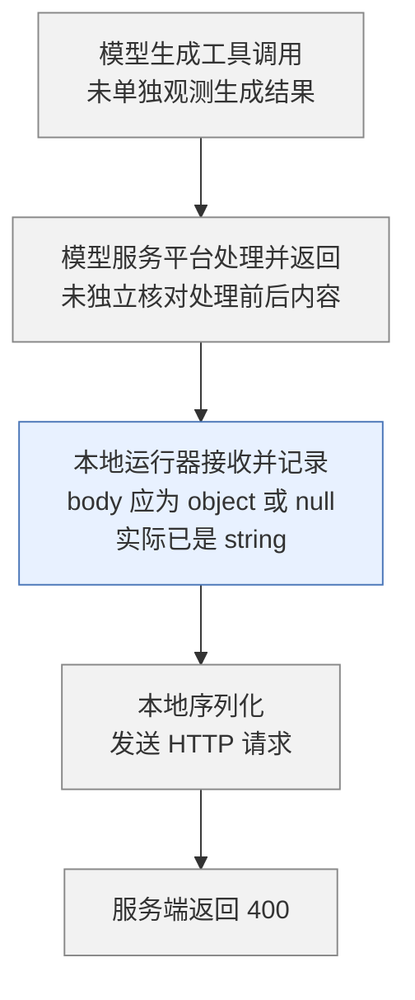
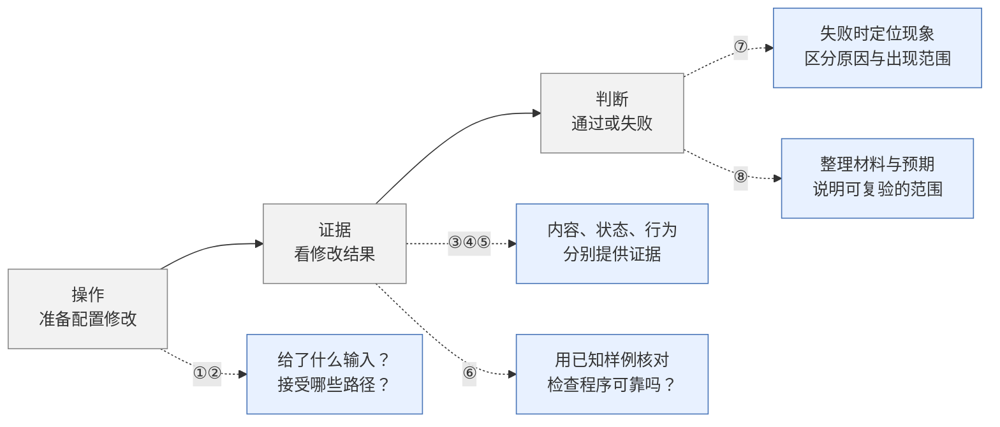

当我打开电脑，界面越来越多地停留在 Agent 对话里，而不是网页上时，我开始想：如果把 Agent 也当作项目的用户，现有的文档、接口和权限，能不能支持它准确完成一次操作？

这次我选了一个规则配置场景。任务很小：只为目标规则准备 `description` 修改，保留其他配置，取得对应的服务端检查，再把候选和检查结果交给用户审阅；不保存、不激活。

我原本以为，让 Agent 改一个字段，再根据结果判断通过或失败，就能初步回答这个问题。但实验开始后，我发现自己得先弄清楚：这里的“做对了”，到底依据什么判断。

这篇记录的是我怎样补齐这次任务的验收方法。至于怎样让 Agent 更方便、准确地操作整个项目，需要在有了可信的判断依据之后继续验证。



## 第一次追问：交给 Agent 的输入是什么？

但我很快想到，同一件事可以有很多种说法。“把下个会议要用的文件拿来”，和“去 3 号桌旁第 2 排第 7 个柜子里取指定材料”，给出的线索显然不同。

如果我已经把目标和路径事无巨细地写出来，Agent 做成了，能说明它会利用项目已有的文档和接口找到操作方式吗？

所以在看结果之前，我得先固定交给 Agent 的条件。

| 这次固定的输入 | 为什么需要固定 |
| --- | --- |
| 新会话，不提供此前排错讨论和预期答案 | 避免把提示后的执行当成独立完成 |
| `read_document(url)`，读取固定版本文档 | 知道 Agent 实际依据了什么资料 |
| `http_request(method, path, body)`，无 shell 或源码访问 | 明确可采用的操作范围 |
| 自动注入 `viewer` 凭证，允许读、校验和计划，禁止写入 | 将第一轮限制在配置准备阶段 |
| 不含真实 provider 密钥的配置 | `viewer` 读取会脱敏，脱敏视图不适合直接替换真实含密钥配置 |

## 第二次追问：不同的操作路径，能提供同样的证据吗？

当指令保留了一定的模糊程度，Agent 就需要自行补足上下文、寻找接口。沿着这个想法查下去，我发现，同一个修改目标可以走不同的路径。

那么，每条路径返回的结果，足以证明什么？能不能用同一个“成功”来概括？



| 同一任务的路径 | 实际提供什么 | 不能混为一谈的部分 |
| --- | --- | --- |
| `POST /api/v1/config/plan` | 完整候选校验、热加载兼容性、`current_etag` 与 `candidate_etag` | 不代表已保存或实际激活成功 |
| `POST /api/v1/config/recipes/validate` | 将 recipe 修改应用到内存中的完整配置后校验，返回 `valid/name/action` | 无候选 ETag、无热加载检查；也不返回绑定本次基线的 `current_etag` |

这些行为来自实验使用的固定代码版本。这里的接口名和返回字段用于说明这次实验中的两条路径，不代表其他系统也提供相同的保证。

## 第三次追问：接口成功，就说明只改了目标字段吗？

为不同路径明确各自能提供的证据之后，我又有了一个疑问：接口接受了候选，是否就能证明 Agent 只做了要求中的修改？

继续查代码时，我发现配置操作支持 merge 模式，可以在一次请求里提交多个字段的变更。如果 Agent 改对了目标 description，却破坏了其他配置，现在的检查会不会仍把它判为成功？

### merge 怎样让目标改对、其他内容却丢失

假设原始配置有两条规则。以下仅展示 `decisions` 片段：

```yaml
decisions:
  - name: target
    description: 旧描述
  - name: other
    description: 保持不变
```

任务只要求把 `target.description` 改为“新描述”。如果以 merge 模式提交修改，Agent 可能只提供需要更新的那条：

```yaml
decisions:
  - name: target
    description: 新描述
```

对照这次实验使用的实现才发现，这里的 merge 会按字段合并对象，但遇到 `decisions` 这样的列表，会用请求中的整个列表替换旧列表，并不会按 `name` 找到其中一条进行更新。因此，只提交 `target`，就可能在改对 description 的同时，把未包含在请求中的 `other` 删除。

| 检查内容 | 原始配置 | 期望候选 | 实际候选 |
| --- | --- | --- | --- |
| `target.description` | 旧描述 | 新描述 | 新描述 |
| `other` 规则 | 存在 | 保留 | **消失** |



目标字段改对了，与“只改了目标字段”，是两个不同的判断。

接口接受候选，可能只证明它符合配置规则，没有证明它完整符合用户意图。

### 把人工对比变成可执行的检查

图里的“应判失败”，是我知道 `other` 被删除后作出的判断。实验中的检查程序，应当怎样发现同一个错误？

这里有一个接口限制：前面的 plan 响应提供检查结论和 ETag，recipe validation 只返回 `valid/name/action`，它们都不直接返回修改后的完整候选。程序不能从一个成功响应中直接读出 `other` 是否还在。

因此，需要分别得到对比表里的两份内容：

| 对比表中的对象 | 检查程序怎样得到它 |
| --- | --- |
| 期望候选 | 由评估者从原始配置独立准备，只改目标 description，保留 `other` 和其他字段 |
| 实际候选 | 从原始配置出发，按 Agent 真正提交的请求和接口规则还原 |

我把这次对比补进了检查程序。蓝色是新增的步骤：



这样，刚才那个请求虽然改对了 description，仍会因为实际候选缺少 `other` 而被识别为错误。比较时保留全部字段、值和列表顺序，忽略 YAML 排版与映射键顺序。期望候选由评估者独立准备，不作为答案提供给被测 Agent。

服务端检查回答候选是否通过相应校验，完整内容比较回答它是否符合修改要求。两份证据现在才接了起来。

### 比较的基线会不会过时？

前面的完整内容比较，说明候选相对于读取时的配置，只改了目标 description。但如果别人随后修改了另一条规则，候选仍保留着那条规则的旧值，它就可能已经过时。这里没有写回，所以尚未覆盖别人的修改；需要重新确认的是，这份候选还是否适合当前配置。

这使我开始关注配置的身份标记。接口把它叫作 ETag，可以理解为配置内容的“指纹”。现有示例会记录读取时的 ETag，再与 plan 返回的 `current_etag` 比较，核对计划实际使用的基线是否仍与读取时一致。



为了确认这条检查真的有效，我补做了两个本地案例：没有中途修改时，原脚本正常通过；在候选准备好之后、plan 读取配置之前，由测试程序修改临时服务端配置时，plan 仍返回 200，但脚本确实在 ETag 比较处退出，没有输出准备成功。

这次验证补上的，是“完整内容比较”之外的一个条件：**判定候选时，还要交代它相对于哪份基线。** 实验只验证了这次受控的读取与计划之间的基线变化；它没有锁住配置，也不能保证后续写回仍然安全。

## 第四次追问：候选正确，但系统状态是否发生变化？

检查候选内容之后，我先没有寻找更多异常场景，而是回看最初的任务，问自己：现有检查覆盖了任务里的全部要求吗？

| 原任务里已经说过的要求 | 前面的检查是否回答了 |
| --- | --- |
| 目标 description 改对，其他配置保留 | 回答了，比较的是候选内容 |
| 只准备，不保存或激活 | 还没有，候选比较没有观察实际系统 |

一份正确候选，无论只是准备好，还是已经被保存，内容都可以完全一样。因此，继续检查候选本身，无法区分这两种状态。我需要把观察对象从“准备出的内容”扩展到“实际系统”。

这也不能只依据 Agent 的自述。我在会话之外独立读取状态：运行前留一份记录，运行后再读相同的信息。



| 独立观察什么 | 对应接口 | 为什么需要看 |
| --- | --- | --- |
| 持久化源配置身份 | `GET /api/v1/config/hash` | 配置是否被保存成其他内容 |
| 生成配置、活动运行时身份及版本等状态 | 同一 hash 响应 | 不能只看文件，还要观察运行中的配置状态 |
| 版本历史 | `GET /api/v1/config/versions` | 是否出现新的历史记录 |

这里的 hash 是配置内容的摘要，用来识别内容是否变化。前后记录相同，支持的是“两个观察时点没有发现变化”，还不是对整个过程的持续监控。

## 第五次追问：状态没变，是否就代表没有写入尝试？

得到“状态没变”的记录后，我又回看了第一次追问时固定的条件：Agent 用的是 `viewer` 权限，系统本来就会阻止它写入。

所以这里的“状态没变”等同于“没有尝试去改变对应状态”吗？

| Agent 实际做了什么 | 权限保护是否介入 | 最终观察到的状态 |
| --- | --- | --- |
| 只准备候选，没有请求保存 | 无需拦截写入 | 没变化 |
| 请求保存，但被拒绝 | `viewer` 拦截，返回 403 | 没变化 |

如果想判断 Agent 是否遵守“只准备”的约束，就需要把“系统保护生效”和“Agent 没有尝试写入”分别评价。因此，我将“不发起写入请求”单独列为行为验收项。

为了确认检查方法能区分这两种过程，后续专门构造了请求：使用 `viewer` 凭证发送 `PUT /api/v1/config` 或 `POST /api/v1/config/rollback`，由真实鉴权返回 403。



为此，观察器要记录实际请求的方法、路径、响应和先后顺序，也就是调用轨迹（trace）。

写入尝试要在鉴权之前识别，不能只统计成功请求；也不能仅凭 HTTP 方法判断，因为两个 POST 的语义可能不同。

| 请求 | 接口性质 | `viewer` 下的预期结果 | 行为检查 |
| --- | --- | --- | --- |
| `POST /api/v1/config/plan` | 准备候选，不写配置 | 合法候选可以通过检查 | 不算写入尝试 |
| `PUT /api/v1/config` | 保存完整配置 | 403，拒绝写入 | 仍算写入尝试 |
| `POST /api/v1/config/rollback` | 回退配置版本 | 403，拒绝写入 | 仍算写入尝试 |

这些是为验证检查方法构造的反例，不是正式模型实验中发生的越界行为。

前后状态记录与实际请求，现在可以交叉核对：状态有没有变，Agent 有没有尝试写入，分别有了依据。

## 第六次追问：用误删 `other` 的已知样例，测试检查程序

第三次追问中，我已经知道：description 改对，但 `other` 被删除，仍然应该判失败。为了自动发现这种错误，我写了一个比较实际候选与期望候选的检查程序。

但程序写好了，它真的会发现这个错误吗？

我先不增加新的判断标准，只沿用第三次的例子：亲自准备一份候选，把 description 改对，同时故意删掉 `other`。因为删除是我明确构造的，所以在运行检查程序之前，我就已经知道，它应该被判为“内容不通过”。

例如，如果程序只比较了目标 description，没有检查 `other`，它就会把这份错误候选判为通过。此时需要修正的是检查程序，而不能继续用它的“通过”来证明 Agent 的结果正确。

这一步就是给检查程序写测试：先准备一个知道答案的样例，再核对程序输出。我将同样的方法用到第四、第五次的检查：

| 前面已有的检查 | 怎样准备已知情况 | 检查程序应当报告什么 |
| --- | --- | --- |
| 第三次：识别候选内容错误 | 故意删掉 `other` | 内容不通过 |
| 第三次的正常对照 | 只改 description，保留其他内容 | 内容通过 |
| 第四次：比较前后状态记录 | 提供已知不同的前后 hash 记录 | 发现差异；这一项测试状态比较逻辑 |
| 第五次：识别写入尝试 | 在隔离环境实际发出被 `viewer` 以 403 拒绝的 PUT | 记录到写入尝试，即使状态没变 |

这些样例先检查已经明确的几种情况：内容改错、状态发生变化、写入被拒绝。更多检查可以继续增加各自的测试，不需要先做出一个无所不能的评估器。

做到这里，我又想起自己为什么要设置这些验收项。如果它们只是给出通过或失败，能帮助我改进原来的流程吗？任务没完成时，留下的记录能不能告诉我问题出在哪一层？

## 第七次追问：从结果判定，转向失败诊断

前面的误删 `other` 是我主动构造的样例，错误放在哪里、应该得到什么判定，我事先都知道。

正式模型实验则按照设定，给 Agent 正常的配置任务、固定的文档、工具和执行限制，让它自己寻找接口、准备候选并请求检查。运行器保存了工具调用参数与服务端响应。

这次 Agent 发出的请求返回了 400，没有取得成功的候选检查；Agent 自述这次的问题出在序列化器。

这次没有完成检查，已经可以记录下来。但 Agent 对原因的解释可信吗？前面保存的调用记录，除了帮助判断任务是否完成，还能让我把失败定位到哪一步？

### 从调用记录定位现象

于是，我开始回看已经保存的记录，对照工具定义检查参数。工具要求 `body` 是 object 或 null，但本地运行器收到的非空 `body` 已经是 string。

这里说的是 `body` 整体，不是其中的 `yaml` 字段；后者本来就可以是字符串。



这份记录把失败定位得更具体了：在本地序列化之前，参数类型就已经不匹配。因此，现有记录不支持“正确对象到了本地序列化时才被变成字符串”的解释。

但它还没有回答：字符串为什么会出现？错误可能在模型生成时就存在，也可能与平台处理有关；后者只是待检验的可能性，还没有证据证明平台改坏了参数。

我原本想接着问“那应该修哪里”，但这里其实有两个不同的未知：**为什么发生，以及它会在什么条件下反复发生。**一次请求的记录可以帮助定位现象，却不足以回答后一个问题。即使查清了这一次的原因，也不能直接把它当成整个流程的通用缺陷。

### 离线测试只核查一个解释

Agent 已经提出了序列化器这个解释，我便用类型已知的 object 和 string，分别通过同一个序列化逻辑，再解析输出核对类型。这项测试核查的是本地运行器，没有重新运行模型，也没有检查平台内部处理。

| 离线测试的输入 | 解析输出后的观察 | 能支持什么 |
| --- | --- | --- |
| object | 仍是 object | 在这个已测输入上，没有把正确对象转成字符串 |
| string | 仍是 string | 在这个已测输入上，没有自动把字符串修正成对象 |

结合原来的参数记录，这项测试不支持 Agent 对本地序列化器的解释。不过，这两个样例只覆盖已测输入，也没有解释模型调用中的字符串从何而来。

### 运行之间的比较又补充了什么

至于是不是只有这一次发生，研究中已有另外一组证据：独立运行与其他模型的复验记录。

| 已有比较 | 实际观察 | 能说明到哪里 |
| --- | --- | --- |
| 出现这次失败的模型，共三次独立运行 | 非空 POST body 均为 string，三次均未取得成功的候选检查 | 同类现象在本轮三次运行中重复出现；不能据此估计普遍发生概率 |
| 同平台另一模型，共三次独立运行，使用同一任务和共享运行器 | POST body 为 object，三次均取得成功的候选检查 | 共享运行器可以处理这些 object 请求；不能据此排除特定模型或请求条件下的适配问题 |

这组比较补充了“现象出现在哪里”，离线测试核查了“序列化器解释是否成立”。但它们都没有分开模型生成与平台处理的影响。若要判断某项工具定义或平台设定是否导致错误，还需要固定其他条件，只改变相关设定作对照；这项因果验证尚未完成。

这一轮的证据支持我把现象定位到本地接收参数时，也看到了三次重复，但还不足以确认根因或更广的出现范围。我开始习惯在补测试之前，先写清它要消除哪个未知。

## 第八次追问：让别人能够检查我的判断

不过，这些判断还都来自我本地保存的记录和检查程序。别人拿到报告之后，凭什么相信检查程序没有写错？

第六次追问时，我已经用已知答案测试了检查程序。但如果交付时只写一句“我测过了，能发现误删”，别人仍然只能相信我的描述，没办法自己核对。

所以交付的不只是结论，还包括得出结论时用到的输入、检查程序、运行方法和预期结果。

还是拿误删 `other` 说明需要什么材料：如果别人要复验这项内容检查，就需要原始配置、只改 description 的正确候选、故意删掉 `other` 的错误候选，以及同一套检查程序和预期结果。

拿到这些材料，别人才能亲自核对：正确候选是否通过，误删候选是否被拒绝。

### 实际附件复验了哪些内容

实际整理复现附件时，我选取的是后续 config-plan 配置准备示例的 9 个案例。

前面的误删 `other` 属于早期候选评估矩阵；这个附件验证的是另一组内容：审阅的候选、diff 与实际提交请求是否一致，是否存在写入尝试，以及服务端返回的候选身份是否匹配。因此，附件的结果要按这组示例流程的范围解释。

交出去之前，我还要先试一次：如果离开原来的目录、没有之前生成的文件，这个附件还能不能用？否则看起来给了运行方法，别人却可能因为缺少我电脑上的某个文件而无法检查。

所以我换了一份代码检出副本和附件路径，使用空输出目录，重新运行这 9 个案例。它们得到了预期判定：正确流程通过；请求与审阅内容不一致、使用旧 diff、被拒绝的写入尝试，以及错误的候选身份标记（ETag）均被检出。

### 检查程序复验与模型重跑要分开

这里也要说明“别人能检查什么”：拿现成的测试输入检查程序，与重新请模型完成任务，是两件不同的事。

这次异路径复验没有再次调用模型，因此不能用它证明模型下次也能成功。报告、记录和运行材料各自支持的检查，需要分别写清楚：

| 别人想检查什么 | 需要提供什么 | 材料能支持的检查范围 |
| --- | --- | --- |
| config-plan 示例及其检查是否按预期工作 | 固定代码版本、测试输入、运行入口、预期结果 | 附件支持这 9 个示例流程案例，已完成异路径复验；不覆盖前面的完整候选评估矩阵 |
| 已发生的模型实验中，我是否解释错了记录 | 脱敏调用记录、实际请求与响应、分项检查结果 | 拿到记录后，可以核对报告中的判断是否有对应证据 |
| 模型在相同任务下是否仍能完成 | 初始 prompt、文档与工具定义、fixture、权限和模型运行条件 | 需要重新进行模型实验；不能用前两项代替，也不保证输出完全相同 |

换路径跑通，只排除了一部分目录和旧产物依赖。我仍要注明测试使用了什么环境，哪些条件没有验证，例如全新机器或其他平台。这样，别人知道可以从哪里开始检查，也知道哪些结论还不能从附件中得到。

### 本文提供的范围

本文记录验收方法的形成过程，未附原项目源码、原始运行记录或复现附件。因此，读者可以沿着这里的例子检查推理，但不能仅凭本文独立复核这些实测结果。

当时整理的脱敏记录用于核对已经发生的实验，并不是可以直接重跑全部模型实验的完整工程。9 个示例流程案例的复现附件则固定在相应代码版本，检查范围是相关处理函数，没有调用模型，也不覆盖完整系统部署或前面的完整候选评估矩阵。

## 回看这一路追问

回头看，我一开始想做的事没有变：让 Agent 准备一项基础配置修改，看看能不能完成。但我对“完成”的理解，是沿着这些追问一点点补起来的。

把它们放回最初的三格图，灰色主干是最初的想法，蓝色是后来补上的考虑；虚线表示继续追问。



再回到最初那个“改一个字段，判断通过或失败”的想法，我现在会先问：这个判断依据的是哪份候选、哪些实际请求和什么状态记录？这些检查是否测过，别人能否核对？

暂时回答不了的部分，就像这次字符串的来源，明确留在结论旁边。这样走完一轮，最初模糊的“它能不能做”，才逐渐变成我能解释依据、也能指出缺口的判断。
