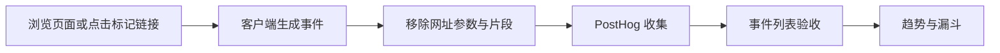

# yukiuix.com 的 PostHog 埋点

先跑通个人站的访问与点击，后续再给 AI 产品增加任务开始、完成和反馈事件。

## 配置

1. 在 PostHog 创建项目，从 Project Settings 取得 **Project API Key**。这是允许出现在浏览器里的项目公开 token，不要使用个人 API Key。
2. 将根目录 `.env.example` 复制为 `.env.local`，填写 `NEXT_PUBLIC_POSTHOG_KEY`；US 项目使用 `https://us.i.posthog.com`。
3. 运行 `npm run dev`，打开 `/zh?analytics_test=1`。环境变量变动后需重启开发服务。
4. 部署时在托管平台设置相同 key/host，并分别设置 `NEXT_PUBLIC_POSTHOG_ENVIRONMENT=preview` 或 `production`，再重新构建。`NEXT_PUBLIC_*` 在构建时写入浏览器代码。

未设置 key 时整个埋点组件不启用。环境未显式设置时，优先识别 `NEXT_PUBLIC_VERCEL_ENV=preview`，最后按开发／生产构建推断为 `dev` 或 `production`。

## 事件字典

| 事件 | 触发条件 | 额外属性 |
| --- | --- | --- |
| `$pageview` | 首次加载及客户端路径变化；仅 query/hash 变化不计数 | 无 |
| `project_link_clicked` | 首页或 Playground 的项目链接 | `project_name`、`placement`、`target_type`、`target_url` |
| `article_link_clicked` | 首页或文章归档中的文章链接 | `article_slug`、`placement`、`target_type`、`target_url` |
| `contact_clicked` | Hero 邮件、页脚邮件／LinkedIn 链接 | `placement`、`target_type`、`target_url` |

所有事件都有 `locale`、`page_path`、`environment`、`is_test`、清理后的 `$current_url` 和 `$referrer`，以及 SDK 的匿名访客、会话、浏览器和设备等基础属性。`placement` 取 `hero`、`footer`、`home_projects`、`playground`、`home_writing`、`writing_archive`；`target_type` 取 `demo`、`submission`、`repository`、`video`、`internal`、`external`、`email`、`linkedin`。

邮件目标只记录 `mailto:`，不会发送邮箱字符串。网址移除 query/hash；关闭 UTM 参数保存、自动交互采集、会话回放、热图、异常、性能、问卷和功能开关请求，不采集页面正文、表单或链接文字。匿名 ID 存在 localStorage；不调用 `identify`，不创建用户资料。

在本次默认配置下，PostHog 服务端仍会接收请求 IP，并可生成城市、国家等 GeoIP 属性；使用匿名 ID 不等于完全不采集个人数据。

## 验收与看板

当前项目：[数据看板](https://us.posthog.com/project/682515/dashboard/2248718) · [事件列表](https://us.posthog.com/project/682515/activity/events)（验收时筛选 `is_test=true`）。

1. 在 PostHog 的事件列表（Activity / Live events）筛选 `is_test=true`，打开 `/zh?analytics_test=1`，确认出现一个 `$pageview`。
2. 通过站内导航进入文章归档、Playground 或切换语言，确认每次路径变化新增一个 `$pageview`；刷新本身也应新增一次。开发环境 Strict Mode 不应导致双发。
3. 点击项目、文章链接和联系入口，确认对应的三种事件及属性。普通点击、键盘激活和鼠标中键支持计数；右键菜单不算点击。
4. 打开带任意 query/hash 的测试地址，检查事件属性不包含参数值；邮件事件的 `target_url` 应是 `mailto:`。邮件点击只代表打开联系入口，不能证明邮件已发送。
5. 新建趋势图查看 `$pageview` 和三种点击；按 `page_path`、`project_name` 或 `article_slug` 拆分。新建漏斗 `$pageview → project_link_clicked`，衡量访问者进入作品链接的比例。

开发环境、预览环境、localhost 和 `.vercel.app` 域名始终标为 `is_test=true`。正式站用 `?analytics_test=1` 标记当前标签页会话，路由跳转和刷新后保留；用 `?analytics_test=0` 清除。正式看板统一筛选 **`environment=production` 且 `is_test=false`**，避免验收点击混入结果。

实现位于 `components/PortfolioAnalytics.tsx`，由语言 layout 挂载；通过 `data-analytics-*` 属性监听目标链接，不改变链接导航行为。SDK 使用异步批量发送，浏览器拦截器或网络失败可能造成少量漏报。

参考：[PostHog Next.js 接入](https://posthog.com/docs/libraries/next-js)、[JavaScript 配置](https://posthog.com/docs/libraries/js/config)。本站为 Next.js 14，使用客户端组件与 `usePathname`；不采用新版本 Next.js 的 `instrumentation-client` 入口。
